  

  

  

<h2 align="center">⚔ THE PRISONER ⚔</h2>

<code>CLASS</code> &nbsp;Student Developer &nbsp;·&nbsp; <code>RUN</code> &nbsp;#∞ &nbsp;·&nbsp; <code>STATUS</code> &nbsp;Still escaping  
🎓 High school junior &amp; <b>Running Start</b> student at <b>Bellevue College</b> 
🧠 Exploring <b>Cognitive Science</b>, <b>AI</b> &amp; <b>Software Development</b> 
🔥 Currently fighting through <b><a href="https://github.com/saiochiro/zzz-mod-manager">ZZZ Mod Manager</a></b> &amp; the <b>Cobbleverse Wiki</b> 
🔌 Side quest: wiring up hardware with <b>Arduino</b> 
🗣 Speaks <b>English</b> &amp; <b>Mongolian</b> 
💀 Died to bugs more times than I can count. Came back stronger every time.

  

<h2 align="center">🗺 QUEST LOG 🗺</h2>

| 🗡 Quest | 🏰 Biome | ⏳ When |
|:--|:--|:--|
| **Director of Communications** | CyberLens AI Lab | Jun – Aug 2026 |
| **Cognitive Science Student** · 24-student cohort | The Ohio State University | Jul 2026 |
| **Software Development Student** | University of Washington | Jul 2026 |
| **AI &amp; Cybersecurity Student** · 50-student cohort | UT Dallas | Jun – Jul 2026 |
| **Director of Communications** | AI &amp; Data Analytics Lab | Mar – May 2026 |

<h3 align="center">🛠 Builds</h3>

<b>Cobbleverse Wiki &amp; Web Platform</b> — web developer on a two-person team building the official wiki <i>(2026 – now)</i> 
<b>Laptops for Mongolian Youth</b> — traveled to Mongolia to get laptops to students who didn't have them <i>(2025)</i> 
<b><a href="https://github.com/saiochiro/zzz-mod-manager">ZZZ Mod Manager</a></b> — Electron + React desktop app for managing game mods

  

<h2 align="center">🏆 BOSS CELLS EARNED 🏆</h2>

| 🏅 Award | 🎖 From | ⏳ |
|:--|:--|:--|
| Certificate of Academic Excellence | Permanent Mission of Mongolia to the UN | 2026 |
| Distinguished Executive Leadership Award | CyberLens AI Lab | 2026 |
| National Recognition Program | College Board | 2026 |
| Mongolian Cultural Ambassador Recognition | Mongolian Cultural Center | 2025 |
| Presidential Gold Award for Volunteer Service | President's Volunteer Service Award | 2025 |

<b>📜 Blueprints unlocked (certifications)</b>

 

Humanities &amp; Cognitive Sciences Institute — <i>The Ohio State University</i> 
AI &amp; Cyber Security Workshop — <i>UT Dallas</i> 
Youth &amp; Teen: Coding in Python I — <i>University of Washington</i> 
Cognitive Psychology — <i>Udemy</i>

  

<h2 align="center">🗡 LOADOUT 🗡</h2>

<code>C++</code> <code>Java</code> <code>JavaScript</code> <code>Python</code> &nbsp;→&nbsp; <b>intermediate, levelling up</b> 
<code>Arduino</code> &nbsp;→&nbsp; <b>comfortable building &amp; wiring projects</b>

  <!-- edit the list after ?i= to match your stack: https://skillicons.dev -->
  

  

<h2 align="center">📜 RUN STATS 📜</h2>

  
  

  

  

  

<h2 align="center">🚪 ESCAPE ROUTES 🚪</h2>

  
  

  

<code>&gt; GAME OVER? NAH. RESPAWNING...</code>

